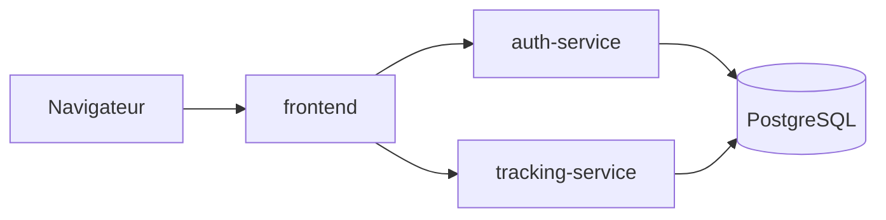

# Muscu Track

Application web de suivi sportif en microservices :

- carnet de charges de musculation (exercices, séances, séries, répétitions, poids) ;
- répertoire de records personnels de course à pied par distance (5 km, 10 km, semi, marathon...) ;
- création de compte et connexion avec double authentification (2FA).

> Projet en cours : seul le squelette est en place pour l'instant (route `GET /health` sur chaque service).

## Architecture



| Service | Technologie | Rôle |
| --- | --- | --- |
| `frontend` | FastAPI, Jinja2 | Pages web |
| `auth-service` | FastAPI | Inscription, connexion, 2FA TOTP, délivrance des JWT |
| `tracking-service` | FastAPI | Séances, exercices et records de course ; vérifie les JWT avec la clé partagée |
| `db` | PostgreSQL | Stockage des données |

## Structure du dépôt

```text
auth-service/        Service d'authentification
tracking-service/    Service de suivi sportif
frontend/            Interface web
deploy/              Manifestes Kubernetes
.github/workflows/   Pipeline CI/CD
.env.example         Modèle des variables d'environnement
```

## Lancer en développement

```bash
cp .env.example .env          # puis remplacer les valeurs "change-me"
docker compose up --build
```

- Frontend : <http://localhost:8080/health>
- API d'authentification et sa documentation interactive : <http://localhost:8001/docs>

`tracking-service` et `db` ne sont joignables que depuis le réseau Docker.

### Lancer les tests de auth-service

```bash
cd auth-service
python3 -m venv .venv
.venv/bin/pip install -r requirements-dev.txt
.venv/bin/pytest
```

Pour tout arrêter : `docker compose down` (ajouter `-v` pour effacer aussi les données de la base).

## Lancer en production

À compléter à l'étape Kubernetes.

## Branches

- `main` : production, branche protégée ;
- `develop` : branche de travail principale ;
- `feature/*` : une branche par fonctionnalité, mergée dans `develop`.

Les commits suivent la convention `feat:`, `fix:`, `docs:`, `chore:`...

## Choix techniques

À compléter au fil du projet.

## Défis rencontrés

À compléter au fil du projet.

## Outils d'IA utilisés

| Outil | Parties du projet |
| --- | --- |
| Claude Code | Création du squelette : arborescence, routes `/health`, `.gitignore`, `.env.example`, ce README |
| Claude Code | Conteneurisation : Dockerfile, `.dockerignore`, `docker-compose.yml` |
| Claude Code | `auth-service` : inscription, connexion, JWT, tests |
