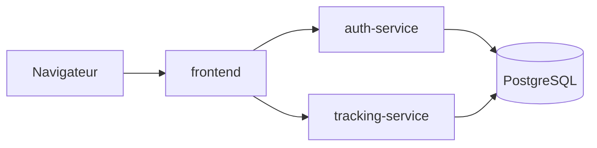
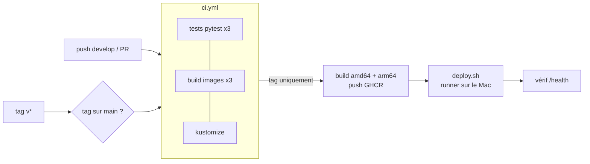

# Muscu Track

Application web de suivi sportif en microservices :

- carnet de charges de musculation (exercices, séances, séries, répétitions, poids) ;
- répertoire de records personnels de course à pied par distance (5 km, 10 km, semi, marathon...) ;
- création de compte et connexion avec double authentification (2FA).

Fonctionnalités :

- inscription, connexion, activation de la 2FA par QR code (Google Authenticator, Aegis...) ;
- saisie d'une séance (date, notes, une ligne par série) et historique des séances ;
- tableau de bord : dernières séances, charge max par exercice, meilleur temps par distance ;
- historique des courses avec mise en évidence des records.

## Architecture



| Service | Technologie | Rôle |
| --- | --- | --- |
| `frontend` | FastAPI, Jinja2, httpx | Pages web ; garde le JWT dans un cookie `HttpOnly` et le transmet aux deux API |
| `auth-service` | FastAPI | Inscription, connexion, 2FA TOTP, délivrance des JWT |
| `tracking-service` | FastAPI | Séances, exercices et records de course ; vérifie les JWT avec la clé partagée |
| `db` | PostgreSQL | Stockage des données |

### Routes des API

`auth-service` : `POST /register`, `POST /login`, `POST /login/2fa`, `GET /me`, `POST /2fa/setup`, `POST /2fa/verify`.

`tracking-service` (toutes les routes exigent un JWT d'accès, sauf `/health`) :

| Route | Rôle |
| --- | --- |
| `POST /sessions`, `GET /sessions` | Créer une séance avec ses séries, lister ses séances |
| `GET /sessions/{id}`, `DELETE /sessions/{id}` | Lire ou supprimer une séance |
| `GET /exercises` | Charge max, nombre de séries et dernière date par exercice |
| `POST /records`, `GET /records` | Ajouter une course (5 km, 10 km, semi, marathon), lister l'historique |
| `GET /records/best` | Meilleur temps par distance |
| `DELETE /records/{id}` | Supprimer une course |

Un utilisateur ne voit que ses propres données : l'identifiant vient du JWT, jamais de la requête.

## Structure du dépôt

```text
auth-service/        Service d'authentification
tracking-service/    Service de suivi sportif
frontend/            Interface web
deploy/              Manifestes Kubernetes
scripts/             Scripts de déploiement sur Kubernetes (local et CI)
.github/workflows/   Pipeline CI/CD (ci.yml, release.yml)
.env.example         Modèle des variables d'environnement
```

## Lancer en développement

```bash
cp .env.example .env          # puis remplacer les valeurs "change-me"
docker compose up --build
```

- API d'authentification et sa documentation interactive : <http://localhost:8001/docs>

`tracking-service` et `db` ne sont joignables que depuis le réseau Docker.

- Application : <http://localhost:8080> (créer un compte depuis la page de connexion)

### Lancer les tests

Chaque service a ses tests ; ils n'ont besoin ni de Docker ni de PostgreSQL (SQLite en mémoire pour les API, services simulés pour le frontend).

```bash
cd auth-service          # ou tracking-service, ou frontend
python3 -m venv .venv
.venv/bin/pip install -r requirements-dev.txt
.venv/bin/pytest
```

Pour tout arrêter : `docker compose down` (ajouter `-v` pour effacer aussi les données de la base).

## Lancer en production (Kubernetes)

Les manifestes sont dans `deploy/` et s'appliquent d'un coup avec Kustomize (intégré à `kubectl`).

| Fichier | Contenu |
| --- | --- |
| `namespace.yaml` | Namespace `muscutrack` qui isole l'application |
| `configmap.yaml` | Configuration non sensible : hôte et nom de la base, URLs des services |
| `secret.example.yaml` | Modèle du Secret (mot de passe de la base, clé JWT) ; le vrai n'est jamais versionné |
| `postgres.yaml` | PersistentVolume + PersistentVolumeClaim, Deployment (1 pod, stratégie `Recreate`), Service ClusterIP |
| `auth-service.yaml`, `tracking-service.yaml` | Deployment (2 pods) + Service ClusterIP, internes au cluster |
| `frontend.yaml` | Deployment (2 pods) + Service LoadBalancer (port `8081`), seul point d'entrée |
| `kustomization.yaml` | Liste des manifestes et version des images |

Déploiement sur un cluster local (Docker Desktop → Settings → Kubernetes → Enable) :

```bash
./scripts/deploy-local.sh
```

Le script (qui appelle `scripts/deploy.sh`, utilisé aussi par la CI) :

1. construit les 3 images avec un **tag unique** (`dev-AAAAMMJJ-HHMMSS`) ; avec un tag fixe comme `latest`, Kubernetes ne verrait pas que l'image a changé et garderait l'ancienne ;
2. crée le namespace et, s'il n'existe pas, le Secret avec des valeurs aléatoires (`openssl rand`), sans rien écrire sur le disque ;
3. applique les manifestes (`kubectl kustomize deploy/`) en remplaçant le tag des images, puis attend que chaque déploiement soit prêt.

Application : <http://localhost:8081>

Commandes utiles :

```bash
kubectl -n muscutrack get pods,svc,pvc        # état du déploiement
kubectl -n muscutrack logs deploy/frontend    # logs d'un service
kubectl delete namespace muscutrack           # tout supprimer (les données restent sur le volume)
```

Ce que montrent les manifestes :

- **Auto-réparation** : chaque service a une `livenessProbe` sur `/health` ; un pod qui ne répond plus est redémarré, un pod supprimé est recréé (`kubectl -n muscutrack delete pod <nom>`).
- **Persistance vérifiée** : après `kubectl -n muscutrack delete pod -l app=postgres`, les comptes et séances sont toujours là.
- **Mise à jour sans interruption** : `RollingUpdate` avec `maxUnavailable: 0` et une `readinessProbe` ; un nouveau pod reçoit du trafic seulement quand il répond, et un pod arrêté continue de répondre 10 s (`preStop`) le temps que le trafic soit redirigé. Mesuré : 0 erreur sur ~700 requêtes envoyées pendant un `./scripts/deploy-local.sh`.
- **Mise à l'échelle** : `kubectl -n muscutrack scale deployment/tracking-service --replicas=4`.
- **Sécurité** : conteneurs non-root (UID 10001), système de fichiers en lecture seule, aucune capacité Linux ; seul le frontend est exposé.


## CI/CD (GitHub Actions)



| Workflow | Déclencheur | Étapes |
| --- | --- | --- |
| `.github/workflows/ci.yml` | push sur `develop`, pull request vers `develop` ou `main` | tests des 3 services, build des 3 images (sans publication), assemblage des manifestes et vérification qu'aucun Secret n'y figure |
| `.github/workflows/release.yml` | tag `v*` | vérifie que le tag est sur `main` → relance la CI → build multi-architecture et push sur GHCR (`:vX.Y.Z` et `:latest`) → déploiement sur Kubernetes → vérification de `/health` |

Mettre en production :

```bash
git switch main && git pull
git tag -a v1.0.0 -m "Version 1.0.0"
git push origin v1.0.0
```

Le déploiement tourne sur un **runner auto-hébergé** installé sur le Mac qui héberge le cluster, car le cluster Docker Desktop n'est pas joignable depuis les serveurs de GitHub. Il apparaît dans l'onglet *Environments → production* du dépôt.

Installer le runner (une seule fois) : *Settings → Actions → Runners → New self-hosted runner → macOS / ARM64*, suivre les commandes affichées en ajoutant le label `muscutrack` à l'étape `config.sh` :

```bash
./config.sh --url https://github.com/Leop250/MuscuTrack --token <jeton affiché par GitHub> --labels muscutrack
./run.sh    # le runner attend les jobs ; Docker Desktop et Kubernetes doivent tourner
```

Sécurité : seul le job de déploiement, déclenché par un tag (que seul le propriétaire peut pousser), utilise ce runner ; les pull requests tournent sur les serveurs de GitHub. Le secret du cluster et l'accès à GHCR restent sur le Mac : aucun identifiant n'est stocké dans le dépôt (`GITHUB_TOKEN` est fourni par GitHub pour la durée du job).

## Branches

- `main` : production, branche protégée ;
- `develop` : branche de travail principale ;
- `feature/*` : une branche par fonctionnalité, mergée dans `develop`.

Les commits suivent la convention `feat:`, `fix:`, `docs:`, `chore:`...

## Choix techniques

À compléter au fil du projet.

## Défis rencontrés

- **Tag `latest` et Kubernetes** : après une reconstruction, le cluster gardait l'ancienne image (même tag, `imagePullPolicy: IfNotPresent`). Solution : un tag unique par version.
- **Erreurs pendant les mises à jour** : quelques requêtes échouaient quand un pod s'arrêtait avant que le load balancer ne cesse de lui envoyer du trafic. Solution : `preStop` de 10 s, et le frontend retente une fois les requêtes GET/DELETE dont la connexion a été coupée.
- **NodePort inaccessible avec Docker Desktop (mode kind)** : le nœud est lui-même un conteneur dont les ports ne sont pas publiés. Solution : Service `LoadBalancer`, que Docker Desktop relie à `localhost`.
- **`runAsNonRoot`** : Kubernetes ne peut vérifier qu'un conteneur n'est pas root que si l'utilisateur de l'image est numérique ; les Dockerfiles utilisent donc `USER 10001`.

## Outils d'IA utilisés

| Outil | Parties du projet |
| --- | --- |
| Claude Code | Création du squelette : arborescence, routes `/health`, `.gitignore`, `.env.example`, ce README |
| Claude Code | Conteneurisation : Dockerfile, `.dockerignore`, `docker-compose.yml` |
| Claude Code | `auth-service` : inscription, connexion, JWT, 2FA TOTP, route `/me`, tests |
| Claude Code | `tracking-service` : séances, séries, statistiques par exercice, records de course, tests |
| Claude Code | `frontend` : pages Jinja2, gestion du cookie de session, parcours 2FA, CSS, tests |
| Claude Code | Manifestes Kubernetes (`deploy/`), scripts de déploiement, section « Lancer en production » |
| Claude Code | Pipeline CI/CD (`.github/workflows/`) et section « CI/CD » |
