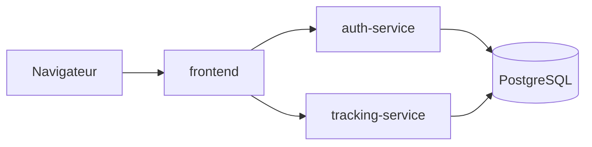

# Muscu Track

Application web de suivi sportif en microservices :

- carnet de charges de musculation (exercices, séances, séries, répétitions, poids) ;
- répertoire de records personnels de course à pied par distance (5 km, 10 km, semi, marathon...) ;
- création de compte et connexion avec double authentification (2FA).

Fonctionnalités :

- inscription, connexion, activation de la 2FA par QR code (Google Authenticator, Aegis...) ;
- saisie d'une séance (date, notes, une ligne par série) et historique des séances ;
- tableau de bord : dernières séances, charge max par exercice, meilleur temps par distance ;
- historique des courses avec mise en évidence des records.

## Architecture



| Service | Technologie | Rôle |
| --- | --- | --- |
| `frontend` | FastAPI, Jinja2, httpx | Pages web ; garde le JWT dans un cookie `HttpOnly` et le transmet aux deux API |
| `auth-service` | FastAPI | Inscription, connexion, 2FA TOTP, délivrance des JWT |
| `tracking-service` | FastAPI | Séances, exercices et records de course ; vérifie les JWT avec la clé partagée |
| `db` | PostgreSQL | Stockage des données |

### Routes des API

`auth-service` : `POST /register`, `POST /login`, `POST /login/2fa`, `GET /me`, `POST /2fa/setup`, `POST /2fa/verify`.

`tracking-service` (toutes les routes exigent un JWT d'accès, sauf `/health`) :

| Route | Rôle |
| --- | --- |
| `POST /sessions`, `GET /sessions` | Créer une séance avec ses séries, lister ses séances |
| `GET /sessions/{id}`, `DELETE /sessions/{id}` | Lire ou supprimer une séance |
| `GET /exercises` | Charge max, nombre de séries et dernière date par exercice |
| `POST /records`, `GET /records` | Ajouter une course (5 km, 10 km, semi, marathon), lister l'historique |
| `GET /records/best` | Meilleur temps par distance |
| `DELETE /records/{id}` | Supprimer une course |

Un utilisateur ne voit que ses propres données : l'identifiant vient du JWT, jamais de la requête.

## Structure du dépôt

```text
auth-service/        Service d'authentification
tracking-service/    Service de suivi sportif
frontend/            Interface web
deploy/              Manifestes Kubernetes
.github/workflows/   Pipeline CI/CD
.env.example         Modèle des variables d'environnement
```

## Lancer en développement

```bash
cp .env.example .env          # puis remplacer les valeurs "change-me"
docker compose up --build
```

- API d'authentification et sa documentation interactive : <http://localhost:8001/docs>

`tracking-service` et `db` ne sont joignables que depuis le réseau Docker.

- Application : <http://localhost:8080> (créer un compte depuis la page de connexion)

### Lancer les tests

Chaque service a ses tests ; ils n'ont besoin ni de Docker ni de PostgreSQL (SQLite en mémoire pour les API, services simulés pour le frontend).

```bash
cd auth-service          # ou tracking-service, ou frontend
python3 -m venv .venv
.venv/bin/pip install -r requirements-dev.txt
.venv/bin/pytest
```

Pour tout arrêter : `docker compose down` (ajouter `-v` pour effacer aussi les données de la base).

## Lancer en production

À compléter à l'étape Kubernetes.

## Branches

- `main` : production, branche protégée ;
- `develop` : branche de travail principale ;
- `feature/*` : une branche par fonctionnalité, mergée dans `develop`.

Les commits suivent la convention `feat:`, `fix:`, `docs:`, `chore:`...

## Choix techniques

À compléter au fil du projet.

## Défis rencontrés

À compléter au fil du projet.

## Outils d'IA utilisés

| Outil | Parties du projet |
| --- | --- |
| Claude Code | Création du squelette : arborescence, routes `/health`, `.gitignore`, `.env.example`, ce README |
| Claude Code | Conteneurisation : Dockerfile, `.dockerignore`, `docker-compose.yml` |
| Claude Code | `auth-service` : inscription, connexion, JWT, 2FA TOTP, route `/me`, tests |
| Claude Code | `tracking-service` : séances, séries, statistiques par exercice, records de course, tests |
| Claude Code | `frontend` : pages Jinja2, gestion du cookie de session, parcours 2FA, CSS, tests |
